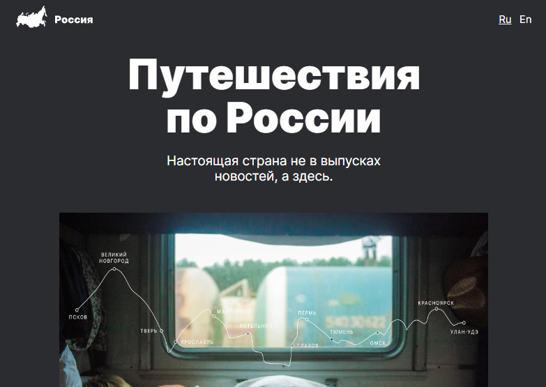
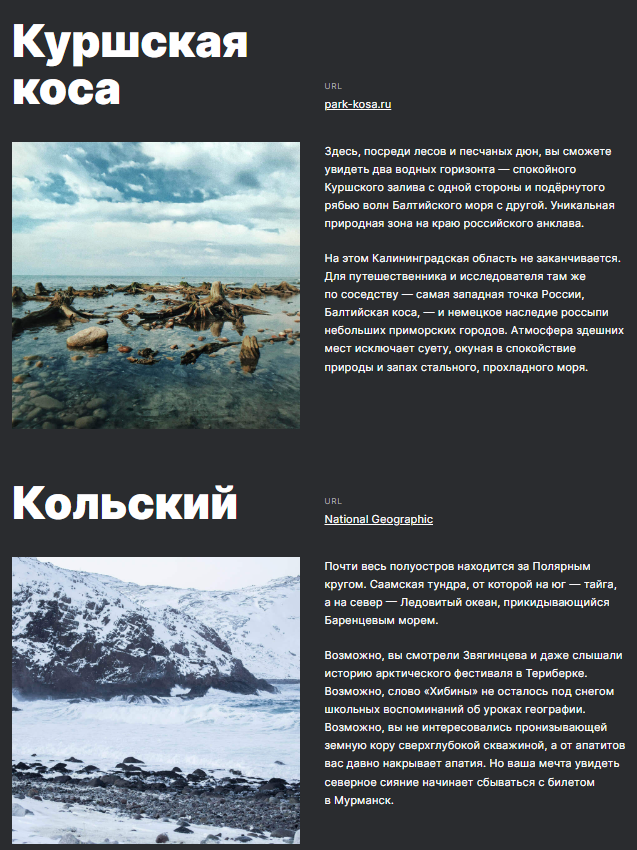
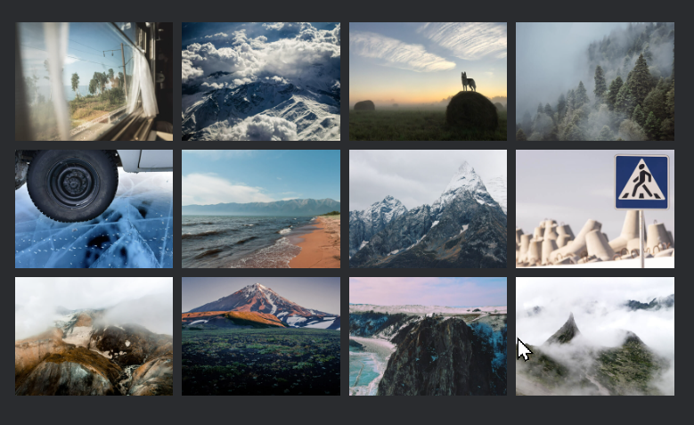
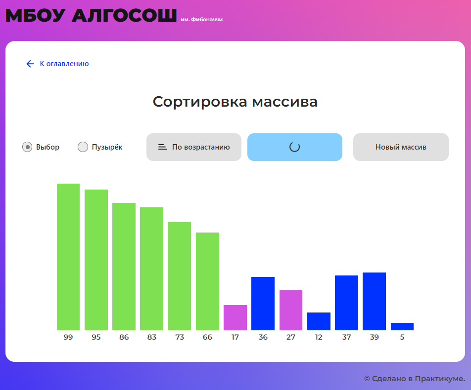
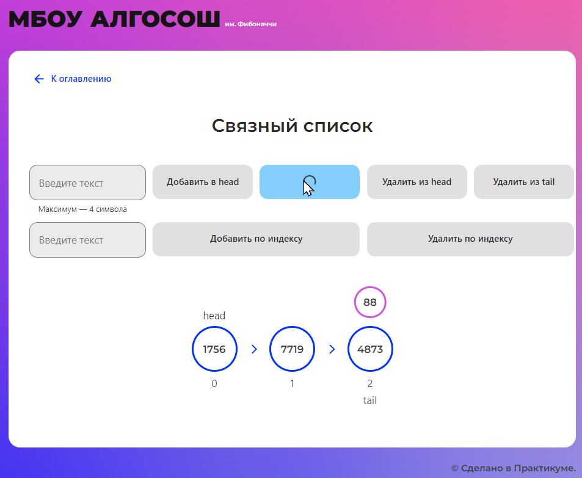
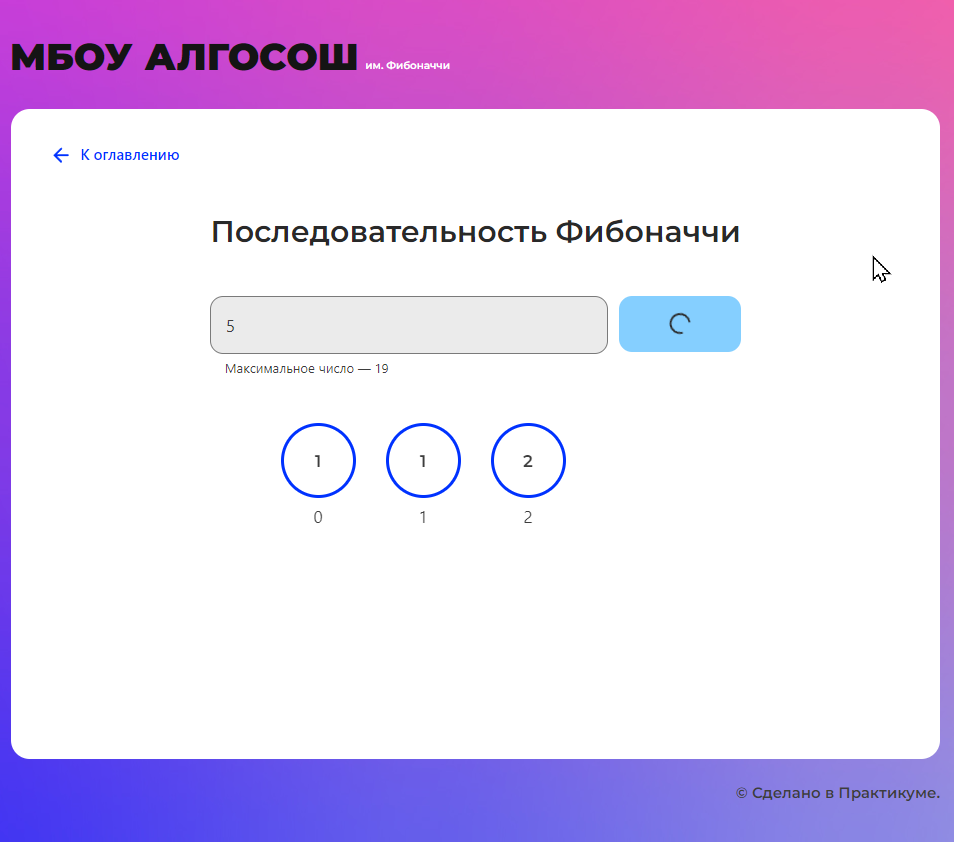
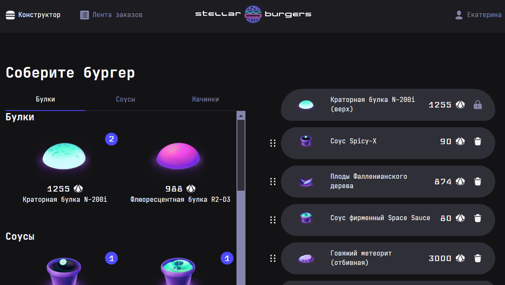
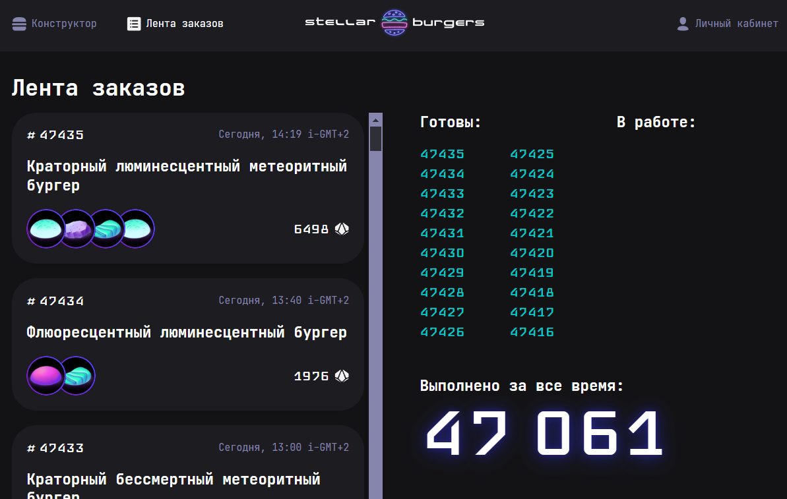
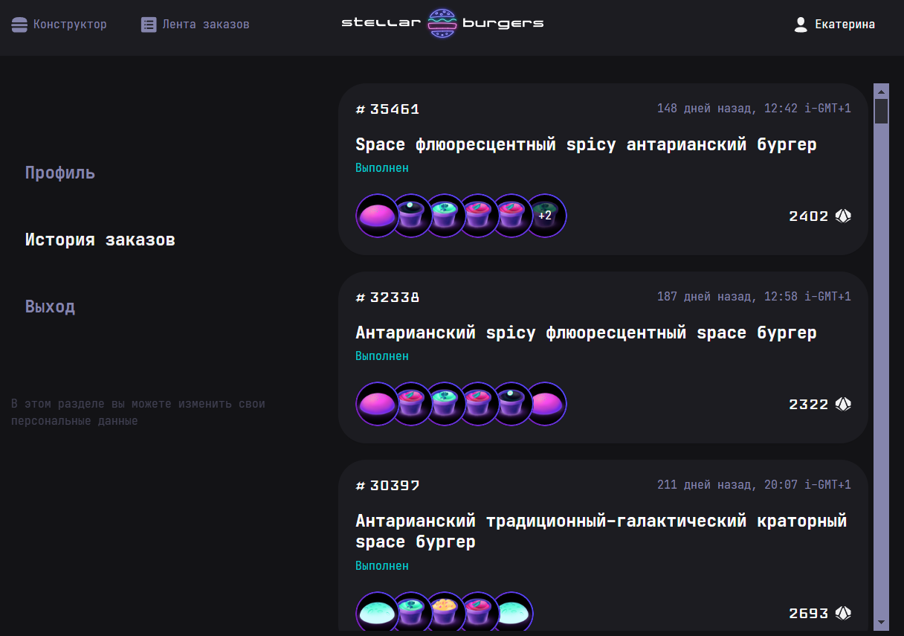

<!---

--->

# 🐼 Привет, меня зовут Екатерина! 🖖

**Я Frontend-разработчик** :octocat:

📆 В ИТ я 8+ лет. Начинала как консультант и разработчик 1С, участвовала в разных проектах — от внедрения готовых решений до автоматизации бизнес-процессов под нужды заказчиков. Часто подключалась к «замороженным» проектам и помогала успешно доводить их до релиза.

💻 Со временем полностью сменила стек и перешла во фронтенд — теперь создаю современные веб-интерфейсы, компоненты, формы и сложную логику на React и TypeScript.

---
🚀**Коммерческий опыт**

Работала над веб-платформами и корпоративными сервисами.
Занималась:
- разработкой интерфейсов и отдельных UI-компонентов на React + TypeScript,
- созданием форм (Formik) и подключением их к API,
- настройкой роутинга и добавлением новых страниц в проект,
- доработкой и поддержкой существующего кода,
- взаимодействием с дизайнерами, бэкендом и тестировщиками.

---
🎓 **Обучение и проекты**

За время обучения на курсе ["Web-разработчик+"](https://practicum.yandex.ru/web-plus/) создала несколько проектов на HTML, CSS, JavaScript и TypeScript, освоила адаптивную вёрстку, React и Redux и написала полноценные учебные приложения от бэкенда до фронтенда.

  

    Разверните для просмотра краткой информации о проектах или перейдите в 
    <a href="https://github.com/gudrum1983#:~:text=Pinned,Loading">📌 Закрепы</a>
  

  <ol>
    <li>
      

        🚋 Путешествия по России [
        <a href="https://github.com/gudrum1983/russian-travel"> 📂 Репозиторий</a> 
        | <a href="https://gudrum1983.github.io/russian-travel">🌐Сайт</a> ]
      

      <ul style="padding-bottom: 10px">
        <li>Создала адаптивный интерфейс с использованием Flex, Grid и медиазапросов для обеспечения корректного отображения сайта на различных устройствах.</li>
        <li>Применяла методологию БЭМ для улучшения структуры и поддерживаемости кода.</li>
        

          
🖼️ Скриншоты сайта

          

            
            
            
          

        

      </ul>
    </li>
    <li>
      

        📊 Визуализатор работы алгоритмов и структур данных [
        <a href="https://github.com/gudrum1983/algososh"> 📂 Репозиторий</a> 
        | <a href="https://gudrum1983.github.io/algososh">🌐Сайт</a> ]
      

      <ul style="padding-bottom: 10px">
        <li>Для реализации пошагового визуализатора работы алгоритмов и структур данных изучила и внедрила паттерн проектирования «Снимок» (Memento), что значительно повысило переиспользуемость кода.</li>
        <li>Проект включает тестирование с использованием Cypress, Jest и React Testing Library.</li>
        

          
🖼️ Скриншоты сайта

          

            
            
            
          

        

      </ul>
    </li>
    <li>
      

        👽 Космическая бургерная 🍔 [
        <a href="https://github.com/gudrum1983/react-stellar-burger"> 📂 Репозиторий</a> 
        | <a href="https://gudrum1983.github.io/react-stellar-burger">🌐Сайт</a> ]
      

      <ul style="padding-bottom: 10px">
        <li>Разработала интерактивное веб-приложение для создания бургеров, управления профилем и отслеживания заказов в реальном времени с помощью WebSocket и REST API.</li>
        <li>Использовала Redux и Middleware для эффективного управления состоянием.</li>
        <li>Внедрила React Router для удобной навигации и работы с заказами, а также react-intersection-observer и Drag-and-drop для улучшения пользовательского опыта.</li>
        

          
🖼️ Скриншоты сайта

          

            
            
            
          

        
      
			</ul>
    </li>
  </ol>
  Так же все вышеперечисленные проекты собраны <a href="https://github.com/stars/gudrum1983/lists/portfolio">👉 в портфолио</a>.

---
✨ **Немного обо мне**

Мне нравится разбираться в задачах, делать интерфейсы удобными и понятными и постепенно улучшать то, что уже есть.
Продолжаю развиваться, экспериментировать и прокачивать навыки в React, TypeScript, архитектуре клиентских приложений и смежных инструментах 🤓💡

🚴 В свободное от учебы время катаюсь на велосипеде и 🧶 вяжу крючком - получается пока хуже, чем проекты на TS, но я уверена что и тут у меня всё получится! 🌟🌟🌟

---
🔮 Skills
---

#### 📧 kochkinaea83@gmail.com | [Telegram](https://t.me/Katherine_Kochkina) | [📄 Резюме на HH.ru](https://hh.ru/resume/9765697bff0fc686d60039ed1f6f554a446f6d)

<!---
gudrum1983/gudrum1983 is a ✨ special ✨ repository because its `README.md` (this file) appears on your GitHub profile.
You can click the Preview link to take a look at your changes.
--->
